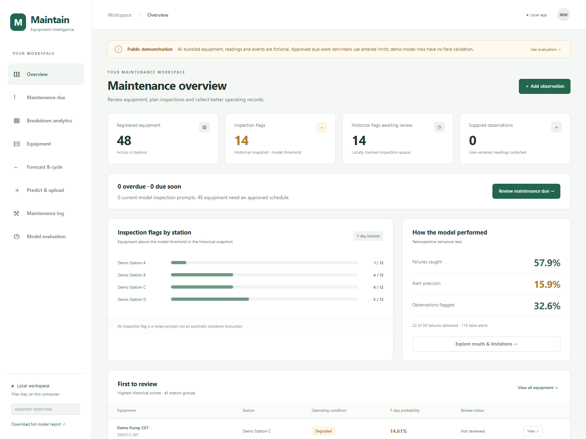
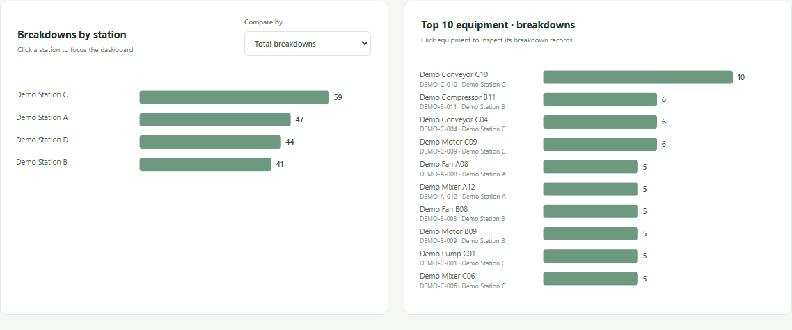
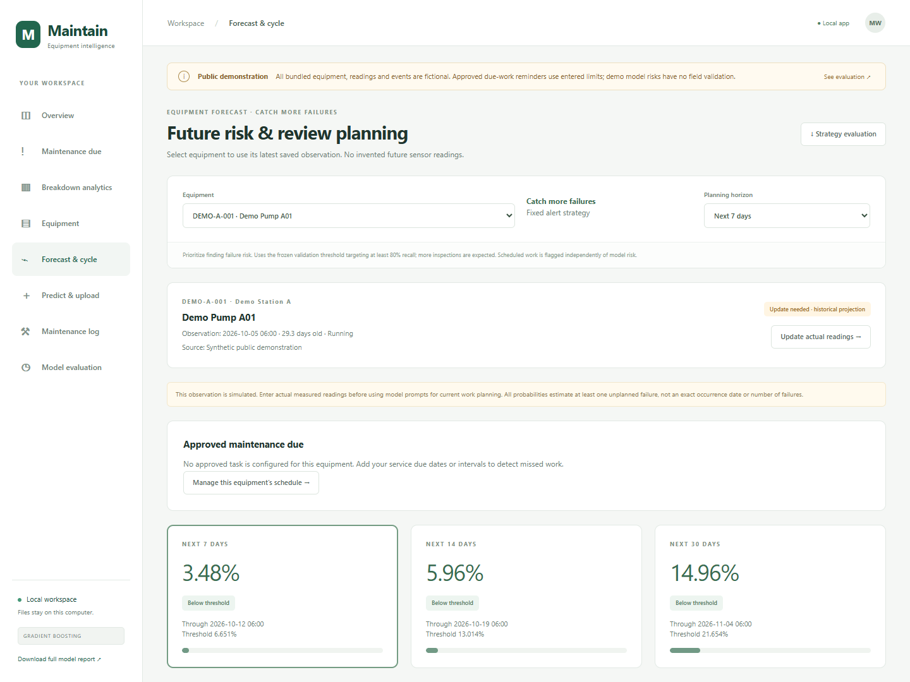
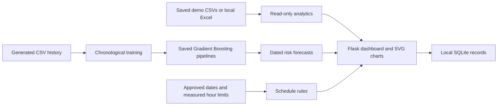

# Predictive Maintenance Dashboard

A working Python dashboard for maintenance schedules, equipment failure-risk forecasts and breakdown analytics from synthetic CSV data, with optional local Excel support.

**Public portfolio demonstration.** Every bundled equipment item, station, reading and maintenance record is independently simulated. The bundled models are trained only on this fictional dataset. This repository contains no workplace register, original maintenance records or private-project trained models. Simulation metrics do not establish real-world predictive accuracy.



## Features

- Plan approved calendar and cumulative operating-hour maintenance, flag overdue work and record completions.
- Export approved dated tasks as an iCalendar snapshot and back up locally entered records with a verified manifest.
- Select equipment for 7-, 14- and 30-day Gradient Boosting risk estimates, with dated readings, historical replay and score explanations.
- Use one alert strategy, **Catch more failures**, selected on validation data.
- Compare stations by total breakdowns and breakdowns per equipment, and rank the top 5, 10 or 20 machines by events or recorded downtime.
- Explore monthly trends, failure modes, work categories, station heatmaps and event drill-downs, with filtered CSV downloads.
- Refresh analytics after saving CSV changes or a locally selected Excel workbook, automatically every minute while visible or on demand.



## Quick start

Use 64-bit **Python 3.12**. Clone or download the repository, then run from its root:

```powershell
python -m venv .venv
.venv\Scripts\python.exe -m pip install -r requirements.txt
.venv\Scripts\python.exe maintenance_app\main.py
```

For Linux or macOS, substitute `.venv/bin/python` and forward slashes. Windows users may also use `maintenance_app/start_app.cmd` after setup. The interface opens at <http://127.0.0.1:8060>. Add `--no-browser` to avoid opening a browser, or `--port 8062` to choose a free port.

This is a local Flask application. Publishing its repository does not host the app on GitHub Pages or provide a background notification service. Alerts update while the app is open and when reopened.

## Try it in five minutes

1. Open **Breakdown analytics**. Switch between Top 5, 10 and 20, choose a station, and click a machine to view event records.
2. Open **Forecast & cycle** and select a demo machine. Read its observation date: bundled observations end on 5 October 2026. The model does not invent today's measurements.
3. Open **Predict & upload**, load a historical example, and calculate a replay without saving it as a new observation.
4. Open **Maintenance due → Plan maintenance** and enter an example due date. Scheduled reminders use that date or a measured meter limit independently of model risk.
5. Edit and save the synthetic CSV files in `maintenance_app/data/demo/`, then click **Refresh data**. The source form can also track a local `.xlsx` inside the project. No Excel workbook is distributed. Invalid saves retain the last good snapshot with a visible warning.

No approved intervals are assumed. Demonstration tasks and any readings you enter remain in an ignored local SQLite database.

## Calendar and local backups

Use **Maintenance due → Calendar snapshot** to export dated approved tasks. For a
consistent backup of locally entered records, run `python tools/backup_local.py`.
See [local operations](docs/OPERATIONS.md) for snapshot limits, backup contents and
recovery steps. Neither feature changes model probabilities or approved intervals.

## Model and evaluation

The demo uses one fixed GradientBoostingClassifier configuration for each horizon, training-only preprocessing, a later calibration period, a separate validation period for alert thresholds and later test dates. Outcome windows are purged across period boundaries. A frozen cumulative-maximum rule keeps longer-horizon probabilities nondecreasing. The model reports the risk of at least one failure within the horizon, rather than an exact date or a remaining-life estimate.

See [Model card](docs/MODEL_CARD.md), [generated evaluation](docs/EVALUATION.md) and the **Model evaluation** page for measured results and limitations. All results concern invented data generated under known rules. No equipment-transfer or field validation is claimed.



## Reproduce the demo

The synthetic CSV bundle and prebuilt models make the app immediately runnable after dependencies are installed. Both `analytics_workbook.xlsx` and its duplicate `training_dataset.xlsx` are excluded from GitHub and the downloadable release. Local Excel files are ignored by Git. To regenerate the deterministic CSV inputs and retrain the demo models:

```powershell
python tools/generate_demo.py
python tools/train_demo.py
```

For the exact dependency versions used in local verification, install `requirements-lock.txt`. A clean [walkthrough notebook](notebooks/Demo_walkthrough.ipynb) demonstrates the data, dated forecasts and evaluation; use the same Python environment as its kernel.

The generator reads no external dataset. It uses a fixed random seed and publishes all simulation rules. Training uses generated CSVs and fingerprints all three input files in a fixed order. Regeneration of CSVs is tested byte-for-byte. No workbook is needed to run, regenerate or retrain the public demo. See [Data guide](docs/DATA.md).

## Tests

```powershell
python -m unittest discover -s maintenance_app/tests -v
```

Tests cover forecast replay, causal features, date and meter schedules, invalid input, transactional completions, workbook refresh/failure retention, CSV escaping and public-data provenance. GitHub Actions is configured to run the suite on Python 3.12. The workflow tests the current branch on GitHub Actions. `VERIFICATION.json` describes the original release; use the latest workflow run for current check status.

## Architecture



```text
maintenance_app/        Flask app, interface, feature code and tests
  data/demo/            Generated CSV inputs and provenance
  data/forecast_models/ Demo-only models, evaluation and training snapshot
  data/model/           Shared feature utilities and generated inference context
  static/, templates/   Browser UI with local assets
tools/                  Reproducible simulation and demo training
docs/                   Model/data guides, evaluation, screenshots and walkthrough
.github/                Automated checks and contribution templates
```

## Next steps for real deployment

Collect verified failure events, normal operating exposure, applicable sensor readings, service-meter continuity and maintenance outcomes. Reserve future real dates for prospective evaluation, measure alert workload as well as failure recall, and validate across equipment and operating conditions. Approved schedules remain authoritative even when the model reports low risk.

## Development and attribution

The project grew from a maintenance-planning use case into an interactive prototype. AI tools assisted with code generation, interface work, documentation and testing. The public demonstration data and models were built separately for this repository. See [Contributing](CONTRIBUTING.md) and [Security](SECURITY.md). No third-party datasets, logos or stock images are bundled. Screenshots show the included fictional application data.

## License

MIT. See [LICENSE](LICENSE). Third-party dependencies retain their own licenses.
